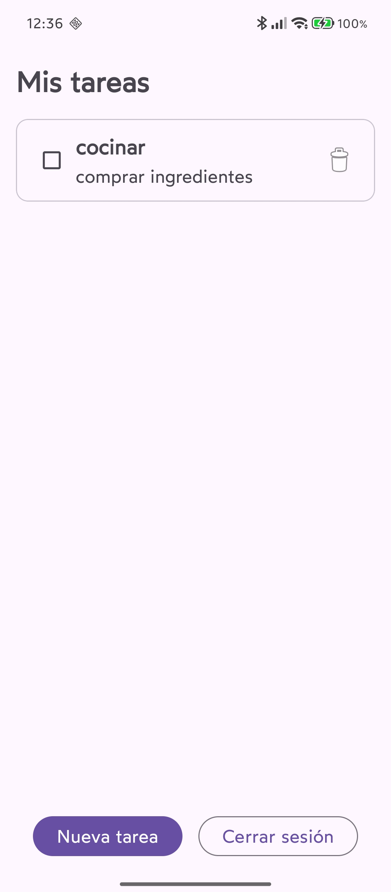
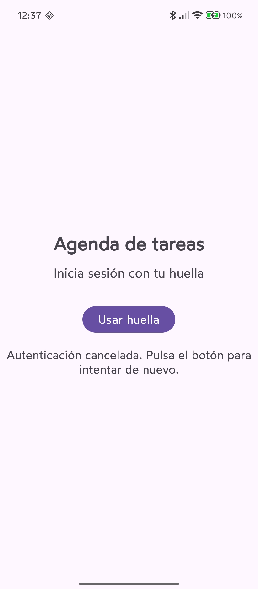

# Agenda de Tareas

App móvil Android nativa, desarrollada en Kotlin, con inicio de sesión mediante huella dactilar.

## Descripción
Aplicación para organizar tareas personales. Al abrirla, el usuario debe autenticarse con su huella. Después puede crear, editar, completar y eliminar tareas.

## Funciones
- Login con huella (BiometricPrompt) con manejo de errores: sin sensor, sin huella registrada, huella no reconocida, cancelación y bloqueo
- Acceso protegido: no se puede entrar sin autenticarse, ni con el botón atrás
- Lista dinámica con RecyclerView y adaptador propio
- CRUD de tareas (crear, leer, actualizar y eliminar)
- Formulario con validación de datos
- Diálogo de confirmación al eliminar
- Modo oscuro
- Cierre de sesión

## Tecnologías
- Kotlin
- ViewBinding
- androidx.biometric 1.1.0
- Material Design
- SharedPreferences para guardar los datos
- minSdk 24

## Cómo ejecutarlo
1. Clona el repositorio
2. Ábrelo con Android Studio
3. Espera a que termine la sincronización de Gradle
4. Conecta un celular con huella registrada y pulsa Run

## Capturas

## Autor
DAFNE MATIAS